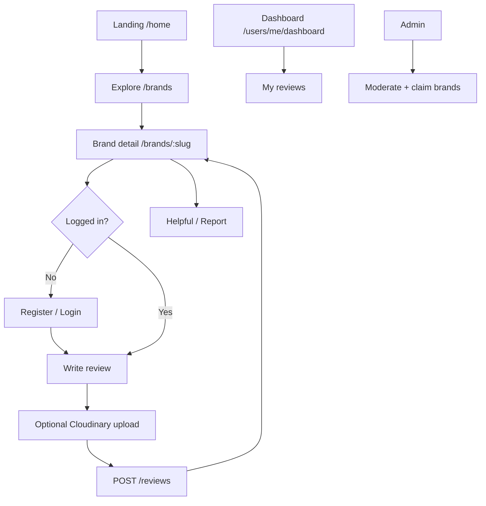

# TalkGround — Frontend Integration Guide

**Audience:** Frontend developers (separate repo)  
**Backend owner:** API team  
**Last updated:** 17 November 2026 (API v1.1)  
**Deploy target:** Render (see [RENDER-DEPLOYMENT.md](./RENDER-DEPLOYMENT.md))

> **API v1.2 (Nov 2026): auth is HttpOnly-cookie only.** No tokens in responses, no `Authorization`
> header. Read **[FRONTEND-AUTH.md](./FRONTEND-AUTH.md)** before writing any auth code.
>
> **API v1.1 (Nov 2026):** review posting now requires verified email + phone, uploads must post the
> signed `params`, and refresh tokens rotate. Read **[API-CHANGELOG-v1.1.md](./API-CHANGELOG-v1.1.md)**
> first — it lists every change and the screens to add.

---

## Frontend handoff (copy these)

| What | Link |
|------|------|
| **API base URL** | `https://revyu-backend.onrender.com/api/v1` |
| **Swagger UI** | https://revyu-backend.onrender.com/docs |
| **OpenAPI JSON** | https://revyu-backend.onrender.com/docs/openapi.json |
| **Auth guide (cookies)** | https://github.com/YudahTech/TalkGround-backend/blob/master/docs/FRONTEND-AUTH.md |
| **This guide (GitHub)** | https://github.com/YudahTech/TalkGround-backend/blob/master/docs/FRONTEND-INTEGRATION.md |
| **API testing guide** | https://github.com/YudahTech/TalkGround-backend/blob/master/docs/API-TESTING-GUIDE.md |
| **Screen → endpoint map** | https://github.com/YudahTech/TalkGround-backend/blob/master/docs/DESIGN-BACKEND-MAPPING.md |
| **Backend repo** | https://github.com/YudahTech/TalkGround-backend |

```env
NEXT_PUBLIC_API_URL=https://revyu-backend.onrender.com/api/v1
```

### Swagger request schemas (DTO examples)

Every write endpoint documents its body in Swagger (Schemas + Try it out):

| Tag | Example DTO |
|-----|-------------|
| Auth | `RegisterDto`, `LoginDto`, `ConfirmOtpDto` |
| Reviews | `CreateReviewDto`, `UpdateReviewDto`, `AddMediaDto`, `ReportReviewDto` |
| Users | `UpdateProfileDto` |
| Uploads | `UploadSignatureDto` |
| Admin | `CreateBrandDto`, `UpdateBrandDto` (`claimed`), `ModerateReviewDto` |
| Growth | `WaitlistDto`, `SurveyResponseDto` |

Open **Schemas** at the bottom of `/docs`, or expand an endpoint → **Request body** to see fields, enums, and examples. To call protected routes, run `POST /auth/login` on the Swagger page first — the browser keeps the session cookie (no Authorize step).

**Demo accounts (after DB seed):**

| Role | Email | Password |
|------|-------|----------|
| User | `chinedu.okafor@gmail.com` | `demo1234` |
| Admin | `admin@revyu.ng` | `admin123` |

---

## 1. Quick start

| Item | Value |
|------|--------|
| **API base (local)** | `http://localhost:3001/api/v1` |
| **API base (live / Render)** | `https://revyu-backend.onrender.com/api/v1` |
| **Swagger (live)** | `https://revyu-backend.onrender.com/docs` |
| **OpenAPI JSON (live)** | `https://revyu-backend.onrender.com/docs/openapi.json` |
| **Auth** | HttpOnly cookies — `fetch(..., { credentials: 'include' })`. See [FRONTEND-AUTH.md](./FRONTEND-AUTH.md) |
| **Content-Type** | `application/json` |

### Frontend env

**Local API:**

```env
NEXT_PUBLIC_API_URL=http://localhost:3001/api/v1
```

**Live / staging (Render):**

```env
NEXT_PUBLIC_API_URL=https://revyu-backend.onrender.com/api/v1
```

CORS: backend `CORS_ORIGIN` on Render must match your frontend origin (e.g. `http://localhost:3000` or your Vercel URL).

> **Cold start:** Render free tier may sleep. First request after idle can take 30–60s — retry once if you see a timeout.

---

## 2. Whole app flow (product → API)



### Guest journey

1. Open app → `GET /home` (hero, trusted cards, sectors, top rated this week).
2. Explore → `GET /brands/filters` + `GET /brands?...`.
3. Brand page → `GET /brands/:slug` + `GET /brands/:slug/reviews`.
4. Public profile → `GET /users/:username`.
5. To write a review → prompt login.

### Logged-in user journey

1. `POST /auth/login` or `register` → keep `data.user` in state (session lives in HttpOnly cookies).
2. Brand page → `GET /brands/:slug/context` → **Write** vs **Edit**.
3. Submit → `POST /reviews` (or `PATCH /reviews/:id`).
4. Photos (optional) → signature → Cloudinary → `POST /reviews/:id/media`.
5. Dashboard → `GET /users/me/dashboard`.
6. Settings → `GET/PATCH /users/me`.

### Admin journey

1. Login as `admin@revyu.ng` (after seed).
2. Queues → `GET /admin/reviews/queue`.
3. Actions → `PATCH /admin/reviews/:id`.
4. **Claim a brand** → `PATCH /admin/brands/:id` `{ "claimed": true }` (admin only).

---

## 3. Response conventions

### Success

```json
{ "data": { ... } }
```

Paginated:

```json
{
  "data": [ ... ],
  "meta": { "page": 1, "limit": 9, "total": 42, "totalPages": 5, "showing": 9 }
}
```

### Error

```json
{
  "error": {
    "code": "BAD_REQUEST",
    "message": "Validation failed"
  }
}
```

| Status | Meaning | Frontend action |
|--------|---------|-----------------|
| 400 | Bad input | Show `error.message` |
| 401 | No/expired session | `POST /auth/refresh` once, retry; still 401 → `/login` |
| 403 | Wrong role / suspended | Show message |
| 404 | Not found | Empty state |
| 409 | Conflict (duplicate) | Show message |
| 503 | Cloudinary not configured | Hide upload UI |

---

## 4. Access model (v1)

| Who | Can do |
|-----|--------|
| Guest | Home, explore, brand detail, read reviews, public profile, register/login |
| USER (JWT) | Write/edit/delete own reviews, helpful, report, dashboard, profile, suggest brand |
| MODERATOR | Everything USER + admin dashboard, review queues/moderation, suggestions, edit brand |
| ADMIN | Everything MODERATOR + create/deactivate brands, users, suspend, roles, audit log (incl. **setting `claimed`**) |

**v1.1:** writing a review requires `emailVerified` **and** `phoneVerified` (API returns `403` otherwise).
Auth is HttpOnly cookies only — see [FRONTEND-AUTH.md](./FRONTEND-AUTH.md).

---

## 5. Brand “Claimed” badge — frontend rules

| Field | Meaning |
|-------|---------|
| `claimed: true` | TalkGround verified the business offline; show Claimed badge |
| `claimed: false` | Unclaimed listing |

**How it becomes true:** only an admin updates the brand. There is **no** public “Claim my business” button wired to the API in v1. Do not invent a claim form that hits a non-existent endpoint.

Trust score already includes +10 when claimed — you can show `trustScore` / `trustLabel` from the API.

---

## 6. Endpoint catalog (why + what)

Base path: `/api/v1` (omit in tables below).

### 6.1 Auth — identity

| Method | Path | Auth | Why it exists | What it does |
|--------|------|------|---------------|--------------|
| `POST` | `/auth/register` | Public | Create accounts | Hashes password, creates USER, returns JWT + user |
| `POST` | `/auth/login` | Public | Session start | Validates email/password, returns JWT + user |
| `POST` | `/auth/forgot-password` | Public | Password recovery stub | Placeholder until Resend email is wired |
| `POST` | `/auth/verify-phone/send-otp` | JWT | Future SMS gate | Sends OTP (or logs in `OTP_DEV_MODE`) |
| `POST` | `/auth/verify-phone/confirm-otp` | JWT | Future SMS gate | Confirms OTP, marks phone verified |

**UI:** Login/Register screens. Keep `data.user` in state; send every request with `credentials: 'include'`. Full auth table: [FRONTEND-AUTH.md §3](./FRONTEND-AUTH.md#3-auth-endpoints).

---

### 6.2 Home — landing page

| Method | Path | Auth | Why | What |
|--------|------|------|-----|------|
| `GET` | `/home` | Public | One call for landing composition | Returns hero, categories, `trustedBrandCards`, `sectorBrands`, `topRatedThisWeek`, featured reviews alias |

**Query (useful):** `?category=restaurants|hotels`, `?q=...`, `?sectorLimit=4`

**UI:** Landing only — do not over-fetch brands list for the first viewport if `/home` already has cards.

---

### 6.3 Brands — explore & detail

| Method | Path | Auth | Why | What |
|--------|------|------|-----|------|
| `GET` | `/brands/filters` | Public | Sidebar without guessing | Cities, categories, ratings buckets **with live counts** |
| `GET` | `/brands` | Public | Explore grid / search | Paginated brands; query: `q`, `city`, `category`, `minRating`, `sort`, `page`, `limit` |
| `GET` | `/brands/:slug` | Public | Brand profile page | Detail: ratings, trust, `claimed`, breakdown, tags, etc. |
| `GET` | `/brands/:slug/context` | JWT | Write vs Edit UX | `{ userHasReviewed, reviewId }` |

**Enums in query strings:** lowercase (`lagos`, `restaurants`) — API normalizes.

**UI rules:**

- Guest can open brand pages.
- Before “Write review”, call `context` if logged in; else send to login.
- Show Claimed badge from `claimed`.

---

### 6.4 Reviews — UGC core

| Method | Path | Auth | Why | What |
|--------|------|------|-----|------|
| `GET` | `/brands/:slug/reviews` | Public / optional JWT | Brand review feed | Paginated reviews; `sort=recent\|rating_high\|rating_low\|helpful\|verified_first`; with JWT → `helpfulByMe` |
| `POST` | `/reviews` | JWT | Create review | Body: `brandId`, `rating`, `title`, `body`, optional `pros`, `cons`, `recommend` |
| `PATCH` | `/reviews/:id` | JWT (owner) | Edit own review | Partial update |
| `DELETE` | `/reviews/:id` | JWT (owner) | Remove own review | Soft/hard per service rules |
| `POST` | `/reviews/:id/media` | JWT | Attach photo/receipt URL | After Cloudinary upload: `{ url, type: "photo"\|"receipt" }` |
| `POST` | `/reviews/:id/helpful` | JWT | Community signal | Toggle/add helpful vote |
| `POST` | `/reviews/:id/report` | JWT | Safety | `{ reason, details? }` → moderation |
| `POST` | `/reviews/:id/view` | Public | Analytics | Increment view counter |

**Why no anonymous reviews:** trust + one-review-per-user-per-brand.

---

### 6.5 Users — me + public profile

| Method | Path | Auth | Why | What |
|--------|------|------|-----|------|
| `GET` | `/users/me` | JWT | Settings screen | Current profile |
| `PATCH` | `/users/me` | JWT | Save settings | `displayName`, `username`, `avatarUrl`, bio fields as allowed |
| `GET` | `/users/me/dashboard` | JWT | Personal dashboard | Stats (`reviewsThisWeek`, `helpfulVotesThisWeek`, …) + recent reviews |
| `GET` | `/users/me/reviews` | JWT | “My reviews” list | Paginated own reviews |
| `GET` | `/users/:username` | Public | Public reviewer profile | Safe public fields + reviews |

**Route order note:** `me` routes are registered before `:username` so `me` is not treated as a username.

---

### 6.6 Uploads — media pipeline

| Method | Path | Auth | Why | What |
|--------|------|------|-----|------|
| `POST` | `/uploads/signature` | JWT | Secure direct-to-Cloudinary | Returns signed params; browser uploads file; API never holds the binary |

Body: `{ "folder": "reviews" | "receipts" | "brands" | "avatars" }`

**v1.1:** post every key in `data.params` with the file (it now includes `allowed_formats`, and
`type=authenticated` for private receipts). See [API-CHANGELOG-v1.1.md §3](./API-CHANGELOG-v1.1.md#3-uploads-cloudinary).

Without Cloudinary env → **503**. Text-only reviews still work.

**Flow:**

1. `POST /uploads/signature`
2. Multipart upload to Cloudinary from the browser
3. `POST /reviews/:id/media` with the CDN URL  
   or `PATCH /users/me` with `avatarUrl`

---

### 6.7 Growth — survey & waitlist

| Method | Path | Auth | Why | What |
|--------|------|------|-----|------|
| `POST` | `/survey/responses` | Public* | GTM validation | Store survey answers |
| `POST` | `/waitlist` | Public | Launch list | Email/phone waitlist entry |
| `GET` | `/waitlist/stats` | Admin | Internal metrics | Counts for founders |

\*Confirm Swagger for exact auth; treat as public marketing forms unless tagged otherwise.

---

### 6.8 Brand suggestions

| Method | Path | Auth | Why | What |
|--------|------|------|-----|------|
| `POST` | `/brand-suggestions` | JWT | Users request missing venues | Creates pending suggestion for admin |

Admin then approves via `/admin/suggestions/:id`.

---

### 6.9 Admin — moderation & claims

All require JWT + `role: ADMIN`.

| Method | Path | Why | What |
|--------|------|-----|------|
| `GET` | `/admin/dashboard` | Ops overview | Counts: brands, reviews, flags, etc. |
| `GET` | `/admin/brands` | Manage catalog | All brands |
| `POST` | `/admin/brands` | Add venue | Create brand; optional `claimed` |
| `PATCH` | `/admin/brands/:id` | Edit + **claim** | Update fields including `{ "claimed": true\|false }` |
| `DELETE` | `/admin/brands/:id` | Soft remove | Deactivate brand |
| `GET` | `/admin/reviews/queue` | Moderation inbox | `?queue=flagged\|reported\|pending_receipt\|suspended` |
| `PATCH` | `/admin/reviews/:id` | Moderate | `{ action: approve\|suspend\|remove\|dismiss_report\|verify_receipt, note?, approved? }` |
| `GET` | `/admin/suggestions` | Missing-brand inbox | Pending suggestions |
| `PATCH` | `/admin/suggestions/:id` | Resolve | `{ status: approved\|rejected, adminNote? }` |
| `PATCH` | `/admin/users/:id/suspend` | Abuse control | `{ suspended, reason }` |

**Claim example:**

```http
PATCH /api/v1/admin/brands/{id}
Cookie: talkground_at=…   (sent automatically by the browser after admin login)

{ "claimed": true }
```

---

## 7. Screen → API mapping

### Landing

| UI | Endpoint |
|----|----------|
| Hero + sections | `GET /home` |
| Trusted cards | `data.trustedBrandCards` |
| Sectors | `data.sectorBrands` |
| Top rated week | `data.topRatedThisWeek` |

### Explore

| UI | Endpoint |
|----|----------|
| Filter sidebar | `GET /brands/filters` |
| Grid | `GET /brands?...` |

### Brand detail

| UI | Endpoint |
|----|----------|
| Header / trust / claimed | `GET /brands/:slug` |
| Reviews | `GET /brands/:slug/reviews?sort=&page=` |
| Write/Edit button | `GET /brands/:slug/context` |

### Review form

| Step | Endpoint |
|------|----------|
| Submit | `POST /reviews` |
| Edit | `PATCH /reviews/:id` |
| Photos | signature → Cloudinary → `POST /reviews/:id/media` |

### Dashboard / settings

| UI | Endpoint |
|----|----------|
| Stats | `GET /users/me/dashboard` |
| Profile | `GET/PATCH /users/me` |

### Admin panel

| UI | Endpoint |
|----|----------|
| Stats | `GET /admin/dashboard` |
| Flagged list | `GET /admin/reviews/queue` |
| Claim brand | `PATCH /admin/brands/:id` `{ claimed: true }` |

---

## 8. Sample API client

```typescript
const API_URL = process.env.NEXT_PUBLIC_API_URL!;

// Simplified. Use the version with automatic refresh in FRONTEND-AUTH.md §5.1.
export async function api<T>(path: string, options: RequestInit = {}): Promise<T> {
  const res = await fetch(`${API_URL}${path}`, {
    ...options,
    credentials: 'include', // sends the HttpOnly session cookies
    headers: { 'Content-Type': 'application/json', ...options.headers },
    cache: 'no-store',
  });
  const json = await res.json().catch(() => ({}));

  if (!res.ok) {
    throw new Error(json?.error?.message ?? 'Request failed');
  }
  return json as T;
}
```

---

## 9. Test accounts (after seed)

| Role | Email | Password |
|------|-------|----------|
| Demo user | `chinedu.okafor@gmail.com` | `demo1234` |
| Admin | `admin@revyu.ng` | `admin123` |

---

## 10. Product scope (v1)

- Categories: **Restaurants** + **Hotels** only  
- Cities: **Lagos** + **Abuja** only  
- Query enums: lowercase  
- Claimed: **admin-only**  

---

## 11. Not required for v1 frontend

| Feature | Status |
|---------|--------|
| Termii SMS | Optional — not required to review |
| Cloudinary | Optional — text reviews work |
| Resend email | Forgot-password placeholder |
| Public “claim business” UI | **Do not build against API yet** |
| Refresh token rotation | Live — cookie-based, see FRONTEND-AUTH.md |

---

## 12. Swagger workflow

1. Start API (local or open Render URL).
2. Open `/docs`.
3. `POST /auth/login` → Execute (the browser stores the session cookie).
4. Try protected routes — no Authorize step needed.

```bash
npx openapi-typescript https://revyu-backend.onrender.com/docs/openapi.json -o src/lib/api-schema.ts
```

---

## 13. Related docs

| Doc | Use |
|-----|-----|
| [SYSTEM-DESIGN-SECURITY.md](./SYSTEM-DESIGN-SECURITY.md) | Architecture + security + claimed policy |
| [RENDER-DEPLOYMENT.md](./RENDER-DEPLOYMENT.md) | Deploy API on Render |
| [API-SPECIFICATION.md](./API-SPECIFICATION.md) | Detailed payloads |
| [API-TESTING-GUIDE.md](./API-TESTING-GUIDE.md) | Manual test checklist |
| [DESIGN-BACKEND-MAPPING.md](./DESIGN-BACKEND-MAPPING.md) | Screen mapping |
